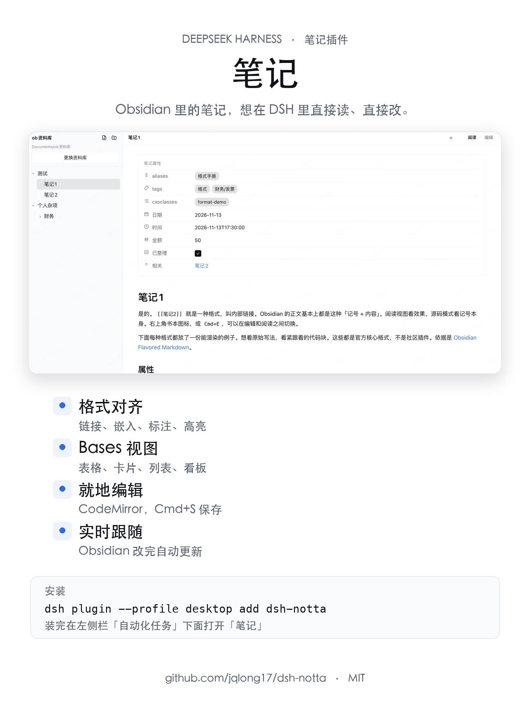

# dsh-notta



在 DSH 左侧栏「自动化任务」下方打开的笔记面板。左边是资料库的文件树，右边按 Obsidian 的格式渲染正文。

一次只打开一个资料库，默认 `/Users/ruska/Documents/ob资料库`，可以在面板里换成别的文件夹。

## 安装

```sh
dsh plugin --profile desktop add dsh-notta
```

或者在插件页的 Discover 里添加市场索引：

```
https://raw.githubusercontent.com/jqlong17/dsh-notta/main/index.json
```

要求 DSH `>=0.2.2-rc.1`。装完刷新页面，左侧栏「自动化任务」下面会出现「笔记」。

## 用法

两个入口共用同一套页面和数据：

- **左侧栏**点「笔记」（排在「自动化任务」下面）→ 占满主区域，左边文件树、右边正文。
- **右侧栏**点 `+`，在菜单里选「笔记」→ 和对话并排显示。同样是左右结构，左侧是 186px 的窄目录：目录标题旁的「«」收起它，收起后阅读区占满，顶部「目录」按钮再展开。

1. 左侧栏点「笔记」，它排在「自动化任务」下面。
2. 点左边文件树里的笔记，右边就是阅读视图。右上角切到「编辑」可以用 CodeMirror 直接改；`Cmd+S` 保存，停止输入 1.5 秒也会自动保存，顶栏显示「未保存 / 保存中 / 已保存」。文件在磁盘上被外部改过时会提示冲突，让你选重新加载还是覆盖。
3. 文件树右上角两个按钮直接**新建笔记 / 新建文件夹**，落在当前选中笔记所在目录；建完立刻在行内改名（回车确认、Esc 取消）。
4. 右键文件或文件夹可以**复制绝对路径**、**重命名**、**删除**；删除是移到资料库的 `.trash` 目录，可以手工找回。右键空白处新建到资料库根目录。
5. **拖拽**文件或文件夹到某个文件夹上即可移动过去，拖到空白处移回资料库根目录。
6. 文件树上方有**搜索框**，`⌘⇧F`（Windows 是 `Ctrl+Shift+F`）直接聚焦；支持 `path:`、`file:`、`tag:` 和普通词，结果显示路径与命中次数。
7. 阅读视图底部是**反向链接 / 出链 / 嵌入**三块，点条目直接跳转，指向不存在笔记的链接会变灰。
8. 笔记里写 `![[某个.base]]` 会**内联渲染成表格**，可以做仪表盘式笔记。
9. 面板会**实时跟随磁盘变化**：在 Obsidian 或 Finder 里改名、新建、删除文件，这边自动更新（宿主用 `fs.watch` 监听资料库，通过 SSE 推给页面），不用手动刷新。
3. 点「更换资料库」，在目录对话框里选另一个文件夹，选「用这个文件夹」生效。

资料库路径保存在 `$DSH_HOME/dsh-notta/settings.json`。面板会写文件：新建/重命名/删除条目、拖拽移动、保存笔记正文、编辑 `.base` 视图。删除是移到资料库的 `.trash`，不会真删。

## 支持的格式

渲染管线是 [react-markdown](https://github.com/remarkjs/react-markdown) 9 + unified/remark/rehype，Obsidian 语法由 [mdian](https://github.com/ngtrio/mdian) 提供：

| 格式 | 说明 |
|---|---|
| `[[笔记]]`、`[[笔记\|别名]]`、`[[笔记#标题]]`、`[[笔记#^块]]` | 内部链接，点击在面板内跳转 |
| `![[笔记]]`、`![[笔记#^块]]` | 嵌入笔记，最多展开两层 |
| `![[图.png\|200]]` | 嵌入图片，按名字在库里找，`\|200` 指定宽度 |
| `` | 普通 Markdown 图片，先按笔记所在目录解析，再按文件名兜底 |
| `![[文件.pdf#page=1&height=280]]` | 内嵌 PDF，用 PDF.js 自绘：页码、缩放、适应宽度 / 适应高度、在新标签打开；`page` 定位页、`height` 定高度（默认 420px） |
| `![[录音.m4a]]`、`![[视频.mp4]]` | 内嵌音频/视频播放器 |
| `> [!info] 标题` | 13 种标注，带类型图标；`-`/`+` 折叠用原生 `<details>` |
| `==高亮==`、`==🔴重要==` | 高亮，6 种颜色 |
| `%%注释%%` | 阅读视图隐藏 |
| 表格、任务列表、删除线、自动链接 | remark-gfm |
| 原始 HTML，如 `<iframe>`、`<video>` | 会解析并渲染；`iframe` 只允许 http(s) 源，自动加 `sandbox` 和 `loading=lazy` |
| `<script>`、`on*` 事件、`javascript:` 链接 | 一律清掉 |
| `$...$`、`$$...$$` | KaTeX，字体随插件本地提供 |
| ` ```mermaid ` | Mermaid 图 |
| ` ```query ` | 搜索嵌入：`path:`、`file:`、`tag:` 和普通词，列出命中的笔记与次数 |
| 顶部 `---` 属性 | 按类型呈现：标签/列表为胶囊、勾选为方框、日期带日历图标、`[[链接]]` 可点 |

图片按文件名在整库里解析，所以附件放在哪个文件夹都能引到；`width` 属性会保留；找不到或加载失败时显示一个带文件名的虚线占位，不会出现破图。文件树里的 PDF 直接用内置 PDF 阅读器打开，图片直接显示。`.canvas`、`.base` 和二进制文件只显示文件信息，不预览。

## Bases

Obsidian 的 Bases 不是数据库，`.base` 只是一个 YAML 视图定义：它存「要哪些文件、按什么排序、显示哪些属性」，Obsidian 再拿库里的笔记和 frontmatter 算成表格。

求值用的是开源的 [@type32/obsidian-bases-parser](https://www.npmjs.com/package/@type32/obsidian-bases-parser)（MIT），它按 Obsidian 1.15 的实际行为实现，表达式语言、全部函数、筛选树、公式、分组和汇总都由它算；本插件只负责把结果画出来。

- 布局：表格（含汇总行）、列表、卡片、看板（`board` / `kanban`），每个视图一个页签。
- 内置属性：`file.name`、`file.basename`、`file.fullname`、`file.path`、`file.folder`、`file.ext`、`file.size`、`file.ctime`、`file.mtime`、`file.tags`、`file.links`、`file.backlinks`、`file.embeds`，以及笔记自身的任意属性。
- 点卡片或第一列文件名可以直接打开对应文件。

- 新建笔记 / 文件夹（按钮或右键，自动命名「未命名」，行内改名），新建的笔记直接打开。
- 重命名（右键），拖拽移动文件与文件夹。
- Bases：新建、重命名、删除视图；切换布局（表格 / 卡片 / 列表 / 看板）；编辑筛选表达式；拖动页签调整顺序；`![[x.base]]` 内联渲染。
- 搜索：`⌘⇧F` 全局检索（路径 / 文件名 / 标签 / 正文），结果显示命中次数。
- 链接：每篇笔记底部显示反向链接、出链与嵌入。
- 编辑：CodeMirror 6 源码编辑（保真，不重排格式）、自动保存、`Cmd+S`、冲突检测（写之前比对 mtime，原子写入）。
- 未做：所见即所得（WYSIWYG）、Live Preview、筛选器的可视化条件构建器、公式编辑器、改列顺序。

## 与 Obsidian 的差异

- 编辑是**源码编辑**（CodeMirror 6），不是所见即所得；记号在编辑时可见，保存后原样写回。
- 图谱没有做；全局搜索只覆盖文件名、路径、标签和正文子串，没有 Obsidian 的完整查询语法。
- `.canvas` 白板只显示文件信息，不渲染卡片内容。
- 属性只展示，不能改类型或新增。
- 外部网页嵌入按原始 HTML 处理，不加载远程脚本。
